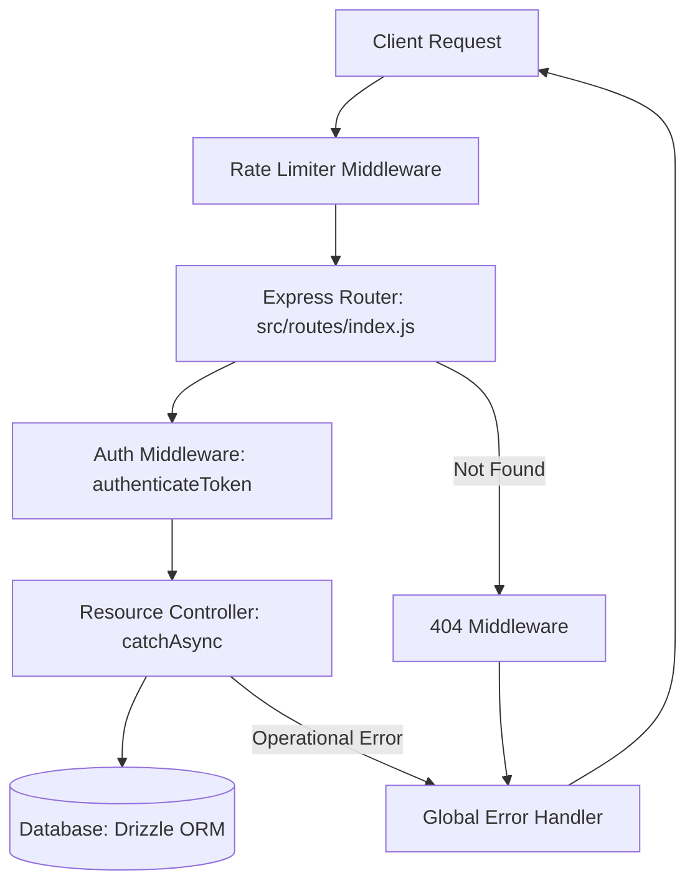

# Expense Tracker Express API: Explanation & Efficiency Improvements

This document explains the architecture implemented for the expense tracker application and outlines strategies to make the code and database interactions more efficient.

---

## 1. Code Architecture & Error Handling

We implemented a standard, clean, and robust structure for handling requests, responses, and errors across the entire codebase.

### Core Architecture Components



1. **`AppError` (`src/utils/AppError.js`)**
   - Inherits from the native JavaScript `Error` class.
   - Captures a specific `statusCode` and marks the error as operational (`isOperational = true`). This differentiates known errors (like `404 Not Found` or `400 Bad Request`) from raw programming errors (like `TypeError` or `ReferenceError`).

2. **`catchAsync` (`src/utils/catchAsync.js`)**
   - Wraps asynchronous Express controllers, intercepting rejected promises (or errors) and passing them down via `next(err)`.
   - Eliminates boilerplate `try-catch` blocks in every controller.

3. **`errorHandler` (`src/middlewares/errorHandler.js`)**
   - Formats responses consistently into a clean JSON structure: `{ status, message, [stack] }`.
   - Safely exposes detailed stacks/errors in `development` but hides them in `production` to prevent leaking system internals.

4. **Rate Limiting & 404s**
   - `rateLimiter.js` guards against DDoS and brute force.
   - `notFound.js` handles requests to unmapped endpoints and formats them via `AppError`.

---

## 2. Resource CRUD Implementations

We implemented CRUD controllers and routes for all 6 core resources, adhering to strict user ownership rules:

* **Users**: Supports register, retrieval, updates, and soft deactivation via `isActive = false` / `deletedAt`.
* **Accounts, Budgets, Transactions, Savings Goals**: All database reads, updates, and deletions are scoped using `.where(eq(table.userId, req.user.id))` to ensure users can only access their own data.
* **Categories**: Shared/global lookup catalog.

---

## 3. How to Make It More Efficient

To optimize the API for performance, throughput, and low database latency, the following improvements can be introduced:

### A. Database Indexing (High Impact)
In `src/db/schema.ts`, adding index constraints to foreign key columns is critical. As tables grow, looking up transactions or budgets by `userId` without index structures forces a sequential full table scan.
* **Solution**: Add indexes for `userId` on `accounts`, `budgets`, `transactions`, and `savings_goals`.
```typescript
// Example: src/db/schema.ts
import { index } from 'drizzle-orm/pg-core';

export const transactions = pgTable('transactions', {
  id: uuid('id').primaryKey().defaultRandom(),
  userId: uuid('user_id').references(() => users.id, { onDelete: 'cascade' }).notNull(),
  // ... other fields
}, (table) => ({
  userIdIdx: index('transactions_user_id_idx').on(table.userId),
}));
```

### B. Narrow Select Fields (Database & Memory Performance)
Selecting entire rows (`select()`) fetches columns that may not be needed by the client, consuming network bandwidth and memory.
* **Solution**: Explicitly select only necessary columns.
```javascript
// Instead of:
const data = await db.select().from(transactions).where(eq(transactions.userId, req.user.id));

// Use selective projection:
const data = await db.select({
  id: transactions.id,
  amount: transactions.amount,
  type: transactions.type,
  createdAt: transactions.createdAt
}).from(transactions).where(eq(transactions.userId, req.user.id));
```

### C. Route-Specific Rate Limiting
Currently, the rate limiter is registered globally on `app.use(rateLimiter)`. Stricter limits should be applied to sensitive endpoints (like `/api/auth/register` and `/api/auth/login`) to prevent authentication attacks, while API data retrievals should have higher limits to support rich client interfaces.
* **Solution**: Move the rate limiter from global middleware and apply customized limits to routers:
```javascript
// src/routes/authRoutes.js
router.post('/register', authLimiter, register);
```

### D. Input Validation Middleware
Currently, invalid fields (e.g., missing name during registration) will execute DB operations until a constraint fails. 
* **Solution**: Register a validation schema (like Zod) middleware to reject malformed requests before contacting the database:
```javascript
const validate = (schema) => (req, res, next) => {
  const result = schema.safeParse(req.body);
  if (!result.success) return next(new AppError(result.error.message, 400));
  next();
};
```
